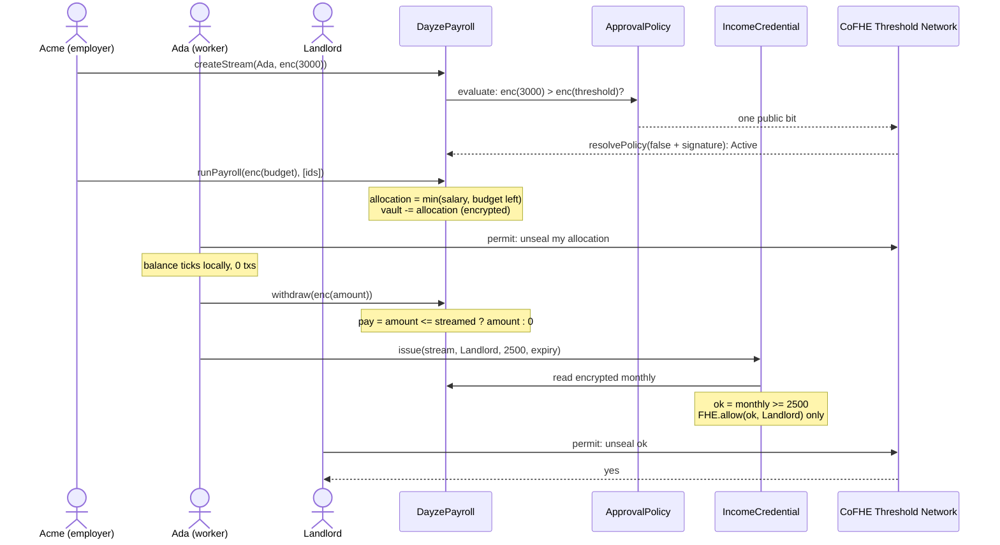

# Dayze

> Salaries stream onchain where nobody can read them, and a worker can prove "I earn at least $2,500" to one landlord without revealing the number.

**Colosseum Crypto World's Fair** · Base track · Built on Fhenix CoFHE, Privy and World ID

[Demo video](https://youtu.be/dLv6DbLrIic) · [Pitch video](https://www.loom.com/share/026691c89b8543dfb411dbcc080552f8) · [Deployed contracts](#deployments) · [Proof it ran](#proof-it-ran) · [Quick start](#quick-start)

---

## The problem

Ada is paid 3,000 USDC a month. If her employer pays her onchain, her salary is public forever: her coworkers, her landlord and any stranger with a block explorer can read it.

Then she applies for a flat. The landlord wants payslips, which show her exact salary and more. Sharing her wallet is worse, because it shows her whole financial history.

So companies keep payroll off-chain, and workers paid in crypto can't prove what they earn without over-sharing.

## How it works

Ada works for Acme Labs at 3,000 cUSDC a month. On testnet a "month" is 10 minutes, so you can watch it happen.

1. **Acme funds payroll.** It shields 5,000 USDC into cUSDC, a confidential wrapper, and moves it into its payroll vault. From here on, every amount is ciphertext.
2. **Acme creates Ada's stream.** The browser encrypts "3,000" before it leaves the page. `ApprovalPolicy` compares it with Acme's encrypted 10,000 threshold. Only one bit becomes public: "above the threshold" or "below it". Below goes Active. Above waits for Acme's approvers (2 of 2 in the demo).
3. **Acme runs payroll** with an encrypted budget. Each stream gets `min(salary for the rest of the period, budget left)`, in table order. A 4,000 budget across two 3,000 streams gives 3,000 and 1,000. Only what is set aside leaves the vault.
4. **Ada watches her pay stream in.** Her app decrypts her own allocation once, with a signed permit, then ticks it up every second. No transactions.
5. **Ada withdraws.** The contract pays `req` if it fits what has streamed, else 0, all on ciphertext. Basescan shows a handle, not an amount.
6. **Ada proves her income.** Her landlord asks for at least 2,500 a month. Ada issues a credential that expires in 7 days. The contract computes `monthly >= 2500` on the encrypted salary and lets only the landlord decrypt the answer. The landlord sees: yes, issued by a World ID-verified human, active since, expires at. Nobody learns "3,000".
7. **Acme's auditor checks the books.** They decrypt salaries, set-aside amounts and withdrawals in their browser and export a CSV. Nothing is uploaded.



## What makes this different

- **Against plain stablecoin payroll (Sablier, Superfluid, a USDC transfer):** those publish every salary. Dayze keeps salary, balance, budget and withdrawal amounts encrypted onchain.
- **Against a ZK proof of income:** a SNARK would need a separate commitment to the salary, plus a proof that it matches the real payments. Dayze's check runs on the stream's own ciphertext ([`IncomeCredential.sol#L101`](https://github.com/Kelechikizito/dayze/blob/44db611d4ed87ed7fd2460a5c5d1c0ceff488502/src/IncomeCredential.sol#L101)), so the proof can't drift from what the worker is actually paid.
- **Against FHE payroll that publishes a permanent "salary ≥ X" flag:** a Dayze credential goes to one verifier, expires, and can be revoked. The worker decides who learns the bit, and for how long.
- **Against "encrypt the salary, hope the vault holds it":** pay never outruns the money. Each period, payroll sets aside what each stream may stream, so a worker can always withdraw what they see.
- **Against payslips:** the landlord learns one bit, plus who paid, since when, and whether the worker is a verified unique human.

## Architecture

Seven contracts, all on Base Sepolia, all source-verified. Every amount is a CoFHE `euint64` handle. Access is granted per handle with `FHE.allow`, and users decrypt with EIP-712 permits. No server holds a key that can read a salary.

### DayzePayroll ([src/DayzePayroll.sol](https://github.com/Kelechikizito/dayze/blob/44db611d4ed87ed7fd2460a5c5d1c0ceff488502/src/DayzePayroll.sol))

Orgs, encrypted per-token vaults and salary streams. Money flows vault → payroll run → stream → worker.
- `createStream` ([L202–L242](https://github.com/Kelechikizito/dayze/blob/44db611d4ed87ed7fd2460a5c5d1c0ceff488502/src/DayzePayroll.sol#L202-L242)) stores the encrypted salary and asks `ApprovalPolicy` for the one public bit.
- `resolvePolicy` ([L246–L259](https://github.com/Kelechikizito/dayze/blob/44db611d4ed87ed7fd2460a5c5d1c0ceff488502/src/DayzePayroll.sol#L246-L259)) is permissionless: anyone can post the decrypted bit, and the Threshold Network's signature proves it.
- `runPayroll` ([L274–L311](https://github.com/Kelechikizito/dayze/blob/44db611d4ed87ed7fd2460a5c5d1c0ceff488502/src/DayzePayroll.sol#L274-L311)) splits an encrypted budget across streams, pro rata for the time left in the period. Finished periods move into `banked`, which stays withdrawable.
- `withdraw` ([L315–L338](https://github.com/Kelechikizito/dayze/blob/44db611d4ed87ed7fd2460a5c5d1c0ceff488502/src/DayzePayroll.sol#L315-L338)) pays 0 on an over-withdrawal instead of reverting, so a failed attempt leaks nothing.
- Streaming is lazy. It's computed in `euint128` only on withdraw ([L379–L405](https://github.com/Kelechikizito/dayze/blob/44db611d4ed87ed7fd2460a5c5d1c0ceff488502/src/DayzePayroll.sol#L379-L405)). Times are plaintext; only amounts are encrypted.

### ApprovalPolicy ([src/ApprovalPolicy.sol](https://github.com/Kelechikizito/dayze/blob/44db611d4ed87ed7fd2460a5c5d1c0ceff488502/src/ApprovalPolicy.sol))

k-of-n approvers per employer, plus an encrypted monthly threshold per token. `evaluate` ([L146–L162](https://github.com/Kelechikizito/dayze/blob/44db611d4ed87ed7fd2460a5c5d1c0ceff488502/src/ApprovalPolicy.sol#L146-L162)) computes `salary > threshold` on ciphertext. It fails closed: a token with no threshold always needs approval.

### IncomeCredential ([src/IncomeCredential.sol](https://github.com/Kelechikizito/dayze/blob/44db611d4ed87ed7fd2460a5c5d1c0ceff488502/src/IncomeCredential.sol))

`issue` ([L90–L125](https://github.com/Kelechikizito/dayze/blob/44db611d4ed87ed7fd2460a5c5d1c0ceff488502/src/IncomeCredential.sol#L90-L125)) compares the live stream's encrypted salary with a plaintext threshold and lets only the named verifier decrypt the result. It records the issuer, expiry, how long the stream has been active, and whether the worker is a verified human. `revoke` and `isValid` handle the rest.

### HumanRegistry ([src/HumanRegistry.sol](https://github.com/Kelechikizito/dayze/blob/44db611d4ed87ed7fd2460a5c5d1c0ceff488502/src/HumanRegistry.sol))

One human, one wallet. The worker does a World ID Selfie Check. The [attest route](https://github.com/Kelechikizito/dayze/blob/44db611d4ed87ed7fd2460a5c5d1c0ceff488502/frontend/app/api/world-id/attest/route.ts) verifies it with World's API and signs an EIP-712 attestation over a salted nullifier. `register` ([L77–L95](https://github.com/Kelechikizito/dayze/blob/44db611d4ed87ed7fd2460a5c5d1c0ceff488502/src/HumanRegistry.sol#L77-L95)) checks the signature and burns the nullifier. Employers see "verified human" next to each payee, and so does a landlord reading a credential.

### AuditRegistry, JoinRequests, confidential tokens

- **[AuditRegistry](https://github.com/Kelechikizito/dayze/blob/44db611d4ed87ed7fd2460a5c5d1c0ceff488502/src/AuditRegistry.sol)** lists each employer's auditors. Payroll grants them every new handle through the [AuditAccess](https://github.com/Kelechikizito/dayze/blob/44db611d4ed87ed7fd2460a5c5d1c0ceff488502/src/libraries/AuditAccess.sol) library.
- **[JoinRequests](https://github.com/Kelechikizito/dayze/blob/44db611d4ed87ed7fd2460a5c5d1c0ceff488502/src/JoinRequests.sol)** lets a worker ask an employer to pay them. The request shows up in the employer console, with no wallet address sent over chat.
- **[ConfidentialToken](https://github.com/Kelechikizito/dayze/blob/44db611d4ed87ed7fd2460a5c5d1c0ceff488502/src/ConfidentialToken.sol)** and **[ConfidentialNative](https://github.com/Kelechikizito/dayze/blob/44db611d4ed87ed7fd2460a5c5d1c0ceff488502/src/ConfidentialNative.sol)** are thin hosts over Fhenix's FHERC20 wrappers: cUSDC, cARB and cETH. Shield and unshield are the only places an amount is plaintext.

### Frontend ([frontend/](https://github.com/Kelechikizito/dayze/tree/44db611d4ed87ed7fd2460a5c5d1c0ceff488502/frontend))

Next.js 16 with five role views: employer console (`/employer`), worker app (`/worker`), approvers (`/approvals`), verifier (`/verify`) and auditor (`/audit`). Employers and workers each get a guided onboarding.
- **Login:** Privy embedded wallets with Google or email, and gas sponsorship, so a worker needs no ETH and no browser extension.
- **Encryption:** inputs are encrypted in the browser with `@cofhe/sdk`, and every decryption uses the viewer's own permit.

## Deployments

### Base Sepolia (84532)

| Contract | Address |
|---|---|
| DayzePayroll | [`0x4121…98E0`](https://sepolia.basescan.org/address/0x4121Bc6A9BF72fDe36BED539F0A2E643394998E0#code) |
| ApprovalPolicy | [`0x0a55…dA89`](https://sepolia.basescan.org/address/0x0a558146fB23F9bDF138440e191E573E4ed3dA89#code) |
| IncomeCredential | [`0x99c0…b106`](https://sepolia.basescan.org/address/0x99c09678A7f193dF3E636B6a5D160715DEE1b106#code) |
| HumanRegistry | [`0x420d…F7b5`](https://sepolia.basescan.org/address/0x420ddf737d5B5742360129205b33311aeb69F7b5#code) |
| AuditRegistry | [`0x85F0…E8f2`](https://sepolia.basescan.org/address/0x85F0Db319Cd689634Ad2012daa5ABBFAf3CdE8f2#code) |
| JoinRequests | [`0xC58C…3511`](https://sepolia.basescan.org/address/0xC58C02D829DCeCB2B646Bf71163Ba1dAF2Ea3511#code) |
| cUSDC | [`0xc2Ab…6674`](https://sepolia.basescan.org/address/0xc2AbF7D3f44Ec03Aa23f4cE08339cE13F8F36674#code) |
| cARB | [`0x7603…04c`](https://sepolia.basescan.org/address/0x7603Aa7d585b00a63036fDFa84bDB0a0FbB2b04c#code) |
| cETH | [`0xbd89…3979`](https://sepolia.basescan.org/address/0xbd896ff7f281bDb9Ca71E88eB6aC72EEcACf3979#code) |
| Test USDC | [`0x953A…95D0`](https://sepolia.basescan.org/address/0x953AD9dC75e355660e28b3FDA5307E588e9a95D0) |

The demo pay period is 600 seconds. All addresses are also in [`deployments/84532.json`](deployments/84532.json).

## Proof it ran

One full payroll cycle on Base Sepolia, from creating the org to USDC landing in the worker's wallet:

| Step | What it proves | Transaction |
|---|---|---|
| Deploy DayzePayroll | Live on Base Sepolia with real CoFHE | [`0x299d…54a0`](https://sepolia.basescan.org/tx/0x299daf62b77d1dac156f6f489e73e4888179e7c97ba1e4d10398207d1edb54a0) |
| Create org | Employer onboarding | [`0x7367…2a79`](https://sepolia.basescan.org/tx/0x73674f31e1e9e54159b0f740112fbcb1797607467e37487931e247fd083a2a79) |
| Fund vault | Amount moves as ciphertext | [`0x3ec9…03e9`](https://sepolia.basescan.org/tx/0x3ec931a034e2413979780b739079439107e36e7614db6fbd001ad8134df303e9) |
| Create stream | The salary is an encrypted input | [`0x1b45…11d3`](https://sepolia.basescan.org/tx/0x1b45d347b03c8777c0d516b0c3ed6df9e9a5b6d8a68a557cc2e9516b670c11d3) |
| Policy check: needs approval | The decrypted bit, posted with its signature | [`0x9050…981a`](https://sepolia.basescan.org/tx/0x9050665fbccf11aad6f9fc0d942b78436a11eef2a9bcc7911eff4f4eb7a8981a) |
| Approver signs | k-of-n approval | [`0xe5dd…ac27`](https://sepolia.basescan.org/tx/0xe5dd5dc93b8564d0359a21cc81b9164c29d35d4c3bef8ff66cbff3c634f7ac27) |
| Stream activated | Approval enforced onchain | [`0x9c18…2d92`](https://sepolia.basescan.org/tx/0x9c182246cbb2e56b454140ffe89e2699059ba4580a1c019ad5db0cdeaf382d92) |
| Worker registered as human | World ID Selfie Check attestation accepted | [`0x089d…0bbb`](https://sepolia.basescan.org/tx/0x089d736d85dcd121c19baaf7fcb34ecef3416a02cf87a631f142bd67de110bbb) |
| Run payroll | Encrypted budget split across streams | [`0xbbc2…e365`](https://sepolia.basescan.org/tx/0xbbc2de5b8c904c29e76d98bc094bc9575e5712921f9299039ce02faa633ee365) |
| **Withdraw** | **No readable amount anywhere in the tx** | [`0x11a5…e82d`](https://sepolia.basescan.org/tx/0x11a575e561ecf543ac84133554abea667c13c3e734e7caa690fd7d6901cbe82d) |
| Unshield | Cash out starts; the amount becomes public here, by design | [`0x8956…e750`](https://sepolia.basescan.org/tx/0x89568a42a373319b2c37d2acea6ee25fe22e0580418cab1fb35c472de9c6e750) |
| Claim | 2,000 USDC lands in the worker's wallet | [`0x9a3f…5b63`](https://sepolia.basescan.org/tx/0x9a3f1db3887d00b696561ca0a6a9a1c7d45ee8d098b16c90152f6e12bd035b63) |

## Quick start

Prerequisites: [Foundry](https://book.getfoundry.sh/getting-started/installation), Node 20+.

```bash
git clone --recursive https://github.com/Kelechikizito/dayze.git
cd dayze
make install        # submodules: forge-std, OpenZeppelin, CoFHE, Fhenix contracts
make test           # 128 tests on CoFHE mocks
```

Run the app against the live Base Sepolia deployment:

```bash
cd frontend
npm install
npm run dev         # http://localhost:3000
```

`frontend/.env.local` needs:

| Variable | What it's for |
|---|---|
| `NEXT_PUBLIC_PRIVY_APP_ID` | Privy login and embedded wallets |
| `NEXT_PUBLIC_BASE_SEPOLIA_RPC` | Your own RPC; public ones rate-limit |
| `NEXT_PUBLIC_WLD_ENVIRONMENT` | `sandbox` to test with the World ID (Sandbox) app |
| `WORLDID_APP_ID`, `WORLDID_RP_ID`, `WORLDID_RP_SIGNING_KEY` | World ID Selfie Check |
| `ATTESTER_PRIVATE_KEY` | Signs HumanRegistry attestations; must match `HumanRegistry.attester()` |
| `NULLIFIER_SALT` | 32 random bytes; never change it after the first registration |

> Gas is sponsored through Privy for Google and email logins. In the Privy dashboard, turn on Fee sponsorship for Base Sepolia, with "Allow transactions from the client". MetaMask users pay their own gas.

To deploy your own copy: `make deploy` with a Foundry keystore, then `make export-abis`. Run `make help` to list every command.

## Testing

```
Ran 13 test suites: 128 tests passed, 0 failed, 1 skipped (129 total)
```

The skipped suite is the live fork suite, which runs with `make test-fork` (6/6 against the real CoFHE Task Manager on Base Sepolia). CI runs format, contract-size and test checks on every push.

What the tests hold to:
- **A worker is never paid more than has streamed.** The fuzz test varies salary, budget, vault balance, elapsed time and request amount, for both a 30-day and a 10-minute period. It checks the payout, allocation, withdrawn total and vault balance exactly.
- **A stream never streams more than its salary, the payroll budget or the vault.**
- **An over-withdrawal pays 0, never reverts**, so a failed attempt reveals nothing.
- **A decrypt result can't be replayed** on another stream or posted twice (`DecryptReplayTest`).
- **One World ID, one wallet:** a nullifier registers once, and only with the attester's signature.
- **A credential is decryptable only by its verifier**, and is invalid after expiry or revocation.

## Known issues

- **Amounts are public at the edges.** Shielding USDC into cUSDC, and unshielding back, show the amount. That's unavoidable while the underlying token is a plain ERC20. The app warns before unshielding. Spending stays private if the worker keeps funds in cUSDC.
- **Who is paid is public; how much is not.** Payee addresses and stream existence are visible. Encrypting payees with `eaddress` is the next step.
- **The approval check reveals one bit:** whether a salary is above or below a hidden threshold. That's the price of letting anyone resolve the policy without a trusted server.
- **Expiry ends validity, not knowledge.** A landlord who decrypted "yes" still knows it. Credentials are "as of issuance", so short expiries keep them honest.
- **The World ID attester is trusted.** It can mark a wallet as human, but it can't read salaries or move funds. The owner can rotate it with `setAttester`.
- **Removing an auditor doesn't revoke past access.** `FHE.allow` grants can't be withdrawn, so new handles go only to current auditors.

## Why Base

- **CoFHE runs on Base Sepolia**, so every encrypted add, compare and transfer here runs on the real coprocessor and Threshold Network, not a mock.
- **Low fees make the product usable.** Withdrawing whenever you like, issuing one credential per landlord, and sponsoring gas for workers are cheap enough on an L2.
- **Stablecoin payroll is the use case** that onchain finance most obviously breaks today, because every salary is public.

## Tech stack

| Layer | Choice |
|---|---|
| Contracts | Solidity 0.8.25, Foundry, OpenZeppelin |
| Encryption | Fhenix CoFHE (`FHE.sol`, `euint64`, `ebool`, Threshold Network), FHERC20 wrappers |
| Identity | World ID Selfie Check (IDKit 4), EIP-712 attestations |
| Wallets | Privy embedded wallets, gas sponsorship, wagmi, viem |
| Frontend | Next.js 16, React 19, `@cofhe/sdk`, `@cofhe/react` |
| Chain | Base Sepolia |

## What's next

- **Hidden payees.** Encrypt recipient addresses with `eaddress`, so who gets paid is as private as how much.
- **Employer verification.** Attach an organisation attestation to credentials. Today a credential proves what a payroll contract pays, not which company runs it.
- **Portable credentials.** A SNARK wrapper, so a credential can be checked off-chain or on another chain without a CoFHE permit.
- **A payroll agent.** It runs payroll each period within employer-set budgets and caps, so nobody has to press the button.
- **Mainnet**, once CoFHE ships on Base mainnet.

## Team

Built by [Kelechi Kizito Ugwu](https://github.com/Kelechikizito).

## License

MIT, per the SPDX headers in `src/`.
